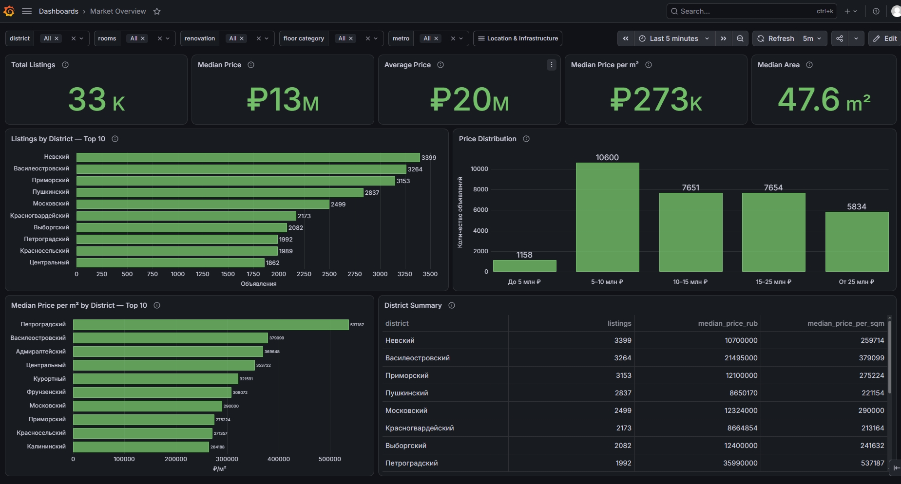
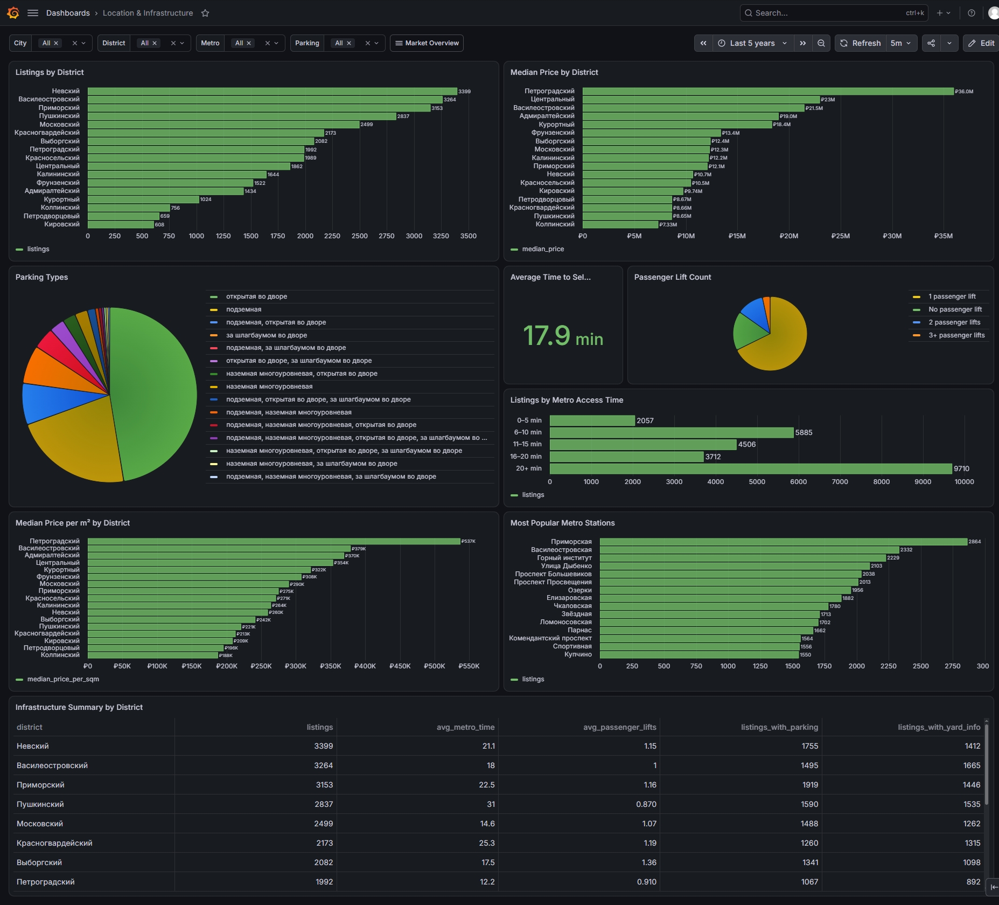

# Real Estate Market Analysis

**End-to-end data analytics project** based on Avito apartment listings. The project prepares listing data, stores it in PostgreSQL, and explores market prices, districts, apartment characteristics, and transport infrastructure through Grafana dashboards.

[English](README.md) | [Русский](README.ru.md)

## Dashboards

### 1. Market Overview

A high-level view of the apartment market: listing volume, typical prices, price per square meter, apartment area, and district-level comparisons.



### 2. Location & Infrastructure

A geographic and infrastructure view: listings and prices by district, metro accessibility, popular stations, passenger lifts, parking, and a district summary.



> Add your Grafana screenshots to `assets/` using the exact filenames shown above. The image placeholders are intentionally not included.

## Project structure

```text
.
├── assets/
│   ├── market_overview.png             
│   └── location_infrastructure.png     
├── data/
│   ├── raw/
│   │   └── avito_clean_final_full.xlsx  
│   └── processed/
│       └── apartments_clean.csv         
├── results/
│   ├── market_overview.json            
│   └── location_infrastructure.json     
├── scripts/
│   └── prepare_data.py
├── sql/
│   ├── market_overview.sql
│   └── location_infrastructure.sql
├── README.md
└── README.ru.md
```

## Tech stack

- **Python:** pandas, NumPy, openpyxl
- **Database:** PostgreSQL
- **Visualization:** Grafana
- **Query language:** SQL

## Data preparation

The source workbook is expected to be named `avito_clean_final_full.xlsx`.

The script `scripts/prepare_data.py`:
- reads the Excel workbook;
- removes duplicate listings using the `url` column;
- renames source columns to English database-friendly names;
- converts selected numeric columns to numeric values;
- calculates `price_per_sqm`;
- creates `floor_category` and `price_segment`;
- exports `apartments_clean.csv` in UTF-8 with BOM encoding.

Run it from the project root:

```bash
python -m pip install pandas numpy openpyxl
python scripts/prepare_data.py data/raw/avito_clean_final_full.xlsx
```

The supplied script writes `apartments_clean.csv` to the current working directory. Move the generated file to `data/processed/` if you want to keep the folder structure above.

## Database and dashboards

The dashboards use the PostgreSQL view:

```sql
public.apartments_analysis
```

The SQL files contain the Grafana variable queries and panel queries discussed for each dashboard:

- `sql/market_overview.sql`
- `sql/location_infrastructure.sql`

The Grafana dashboard exports should be saved in `results/` with the filenames listed in the project structure. Select your own PostgreSQL datasource when importing the JSON files. Do not commit database passwords, connection strings containing credentials, or private configuration.

## Reproducing the project

1. Put `avito_clean_final_full.xlsx` into `data/raw/`.
2. Run the data preparation script.
3. Import the cleaned CSV into PostgreSQL and create the `apartments_analysis` view used by the dashboards.
4. Execute the relevant SQL variable and panel queries in Grafana, or import the dashboard JSON exports after adding them to `results/`.
5. Add dashboard screenshots to `assets/`.


---
