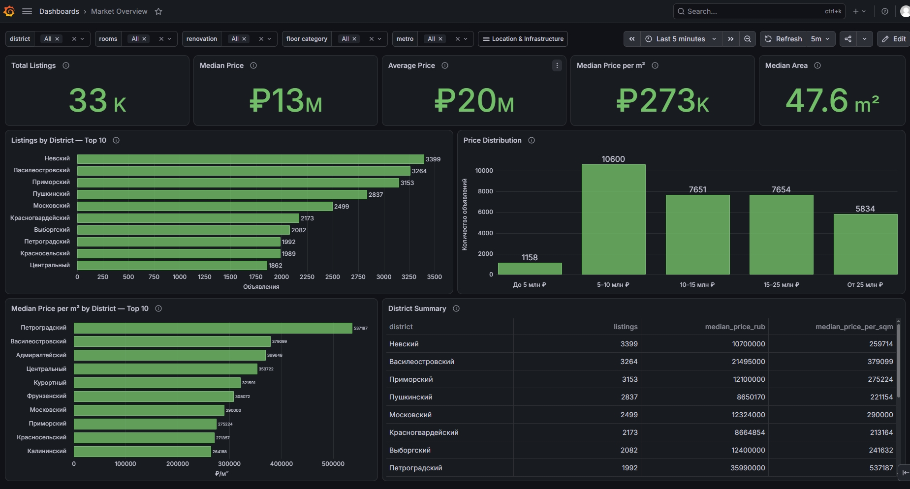
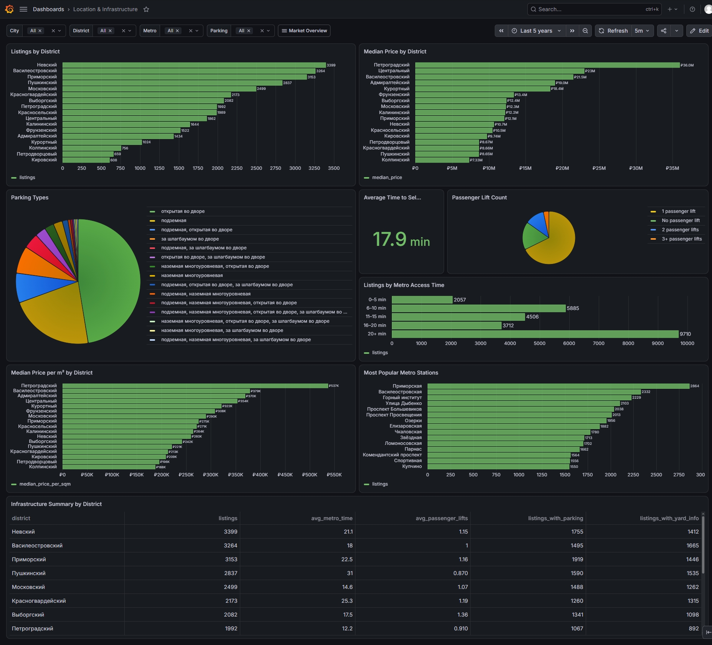

# Анализ рынка недвижимости

**Проект сквозной аналитики данных** на основе объявлений о продаже квартир с Avito. Проект включает подготовку данных, хранение в PostgreSQL и анализ цен, районов, характеристик квартир и транспортной инфраструктуры с помощью дашбордов Grafana.

[English](README.md) | [Русский](README.ru.md)

## Дашборды

### 1. Market Overview — обзор рынка

Общая статистика рынка: количество объявлений, типичные цены, стоимость квадратного метра, площадь квартир и сравнение районов.



### 2. Location & Infrastructure — расположение и инфраструктура

Географический и инфраструктурный анализ: количество объявлений и цены по районам, доступность метро, популярные станции, пассажирские лифты, парковки и сводная таблица по районам.



> Добавь скриншоты Grafana в папку `assets/`, используя указанные выше имена файлов. Заглушки изображений намеренно не включены.

## Структура проекта

```text
.
├── assets/
│   ├── market_overview.png            
│   └── location_infrastructure.png     
├── data/
│   ├── raw/
│   │   └── avito_clean_final_full.xlsx 
│   └── processed/
│       └── apartments_clean.csv         
├── results/
│   ├── market_overview.json           
│   └── location_infrastructure.json   
├── scripts/
│   └── prepare_data.py
├── sql/
│   ├── market_overview.sql
│   └── location_infrastructure.sql
├── README.md
└── README.ru.md
```

## Используемые технологии

- **Python:** pandas, NumPy, openpyxl
- **База данных:** PostgreSQL
- **Визуализация:** Grafana
- **Язык запросов:** SQL

## Подготовка данных

Исходный Excel-файл должен называться `avito_clean_final_full.xlsx`.

Скрипт `scripts/prepare_data.py`:
- читает Excel-файл;
- удаляет дубликаты объявлений по столбцу `url`;
- переименовывает исходные столбцы в англоязычные имена;
- преобразует выбранные столбцы в числовой формат;
- рассчитывает `price_per_sqm`;
- формирует `floor_category` и `price_segment`;
- сохраняет `apartments_clean.csv` в кодировке UTF-8 с BOM.

Установи зависимости и запусти скрипт из корневой папки проекта:

```bash
python -m pip install pandas numpy openpyxl
python scripts/prepare_data.py data/raw/avito_clean_final_full.xlsx
```

Переданный скрипт сохраняет `apartments_clean.csv` в текущую рабочую папку. При необходимости перемести результат в `data/processed/`, чтобы сохранить структуру проекта.

## База данных и дашборды

Дашборды используют представление PostgreSQL:

```sql
public.apartments_analysis
```

SQL-файлы содержат запросы переменных Grafana и запросы панелей, подготовленные для двух дашбордов:

- `sql/market_overview.sql`
- `sql/location_infrastructure.sql`

Экспортированные JSON-файлы Grafana нужно добавить в `results/`, используя имена из структуры проекта. При импорте JSON выбери свой PostgreSQL datasource. Не добавляй в репозиторий пароли, строки подключения с учётными данными и приватные настройки.

## Как воспроизвести проект

1. Помести `avito_clean_final_full.xlsx` в `data/raw/`.
2. Запусти скрипт подготовки данных.
3. Импортируй очищенный CSV в PostgreSQL и создай представление `apartments_analysis`, которое используют дашборды.
4. Выполни запросы переменных и панелей из соответствующего SQL-файла Grafana либо импортируй JSON-экспорты после добавления их в `results/`.
5. Добавь скриншоты дашбордов в `assets/`.
